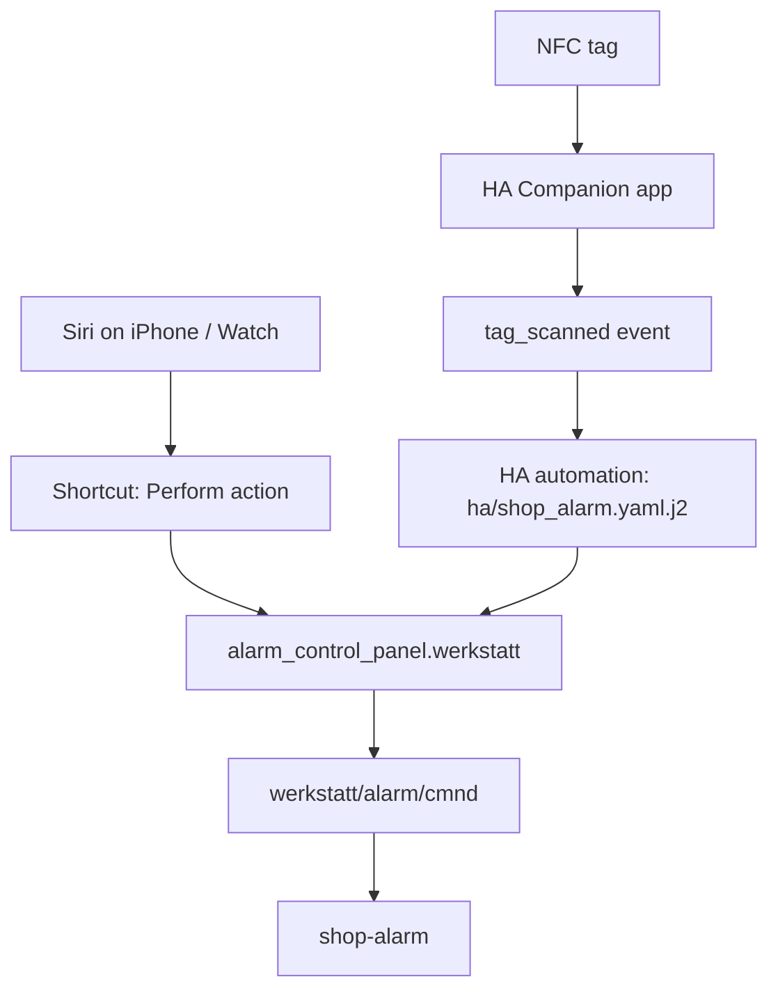

# Siri and NFC for the workshop alarm

This sets up two front ends for `alarm_control_panel.werkstatt`: Siri on the iPhone and Apple Watch, and the two door NFC tags (outside = disarm, inside = arm away). Both end in the same HA service call, so they behave exactly like the panel card: the arming preconditions, the 60 s exit delay / 30 s entry delay, the Frigate profile switch and the shop-alarm audit events are unchanged.

| Action | iPhone / Watch | NFC | HA app |
|---|---|---|---|
| Arm away | "Hey Siri, Arm Workshop" | inside tag | panel card → Arm away |
| Disarm | "Hey Siri, Disarm Workshop" | outside tag | panel card → Disarm |

The Watch cannot read NFC tags (watchOS gives NFC to Apple Pay only); the tags are iPhone-only, and the Watch gets Siri.

## Before you start

* The Home Assistant app on the iPhone must be signed in to the HA instance at `https://ha.tailnet-204f.ts.net` (the Tailscale Service `svc:ha`). The shortcuts and tag scans go through that connection; when you are at the shop, Tailscale must be up on the phone.
* Background NFC reading needs an iPhone XS, XR, 11 or later. Older phones can still scan from inside the app, but not by holding the phone to the tag.
* The Siri route uses the HA app's **Perform action** App Intent, which needs iOS 17 or later. The iPhone 15 Pro is fine.
* The two tags already exist in HA; the IDs are in section 1 below, and section 2 verifies that the physical tags scan. If you ever replace a tag, it must be a writable NDEF tag (NTAG213/215/216 stickers and cards are fine).
* Test the panel card in the app first. If Arm away / Disarm does not work there, fix that before adding Siri or tags.

## Part 1 — Siri on the iPhone and Watch

The HA app exposes Apple App Intents, so this is a Shortcut with one action per verb. Do not use the deprecated "Call Service" action; use **Perform action**.

### Create the arm shortcut

1. Open **Shortcuts** → **+**.
2. **Add Action** → search for **Home Assistant** → choose **Perform action**.
3. **Server**: select the server for `ha.tailnet-204f.ts.net`.
4. **Action**: search for and select `alarm_control_panel.alarm_arm_away`.
5. **Action data**: enter `{"entity_id": "alarm_control_panel.werkstatt"}` (valid JSON, with the quotes).
6. Name the shortcut **Arm Workshop** and save.

### Create the disarm shortcut

Repeat the same steps with `alarm_control_panel.alarm_disarm` and the name **Disarm Workshop**.

The names matter: in current Shortcuts, Siri runs a shortcut by its name, so the shortcut name *is* the voice command. There is no separate "Add to Siri" phrase to record. Name them in whatever language Siri is set to, and avoid a name Siri already uses for a HomeKit accessory.

### Alternative phrases and other languages

To keep the English names and add a German command, duplicate the shortcut (long-press it → **Duplicate**) and rename the copy to the exact phrase you want to say. Siri runs a shortcut by its name, so the name is the command; both copies call the same HA action.

| Verb | Shortcut name (= Siri phrase) |
|---|---|
| Arm away | `Schalte den Werkstatt-Alarm ein` |
| Disarm | `Schalte den Werkstatt-Alarm aus` |

Then say the name exactly: "Hey Siri, Schalte den Werkstatt-Alarm ein". If that is too long, use a shorter name such as `Werkstatt-Alarm ein` and say "Hey Siri, Werkstatt-Alarm ein". Name it in the language Siri is set to. Siri on the Watch uses the same shortcut names. If Siri answers as if "Werkstatt-Alarm" were a device ("I don't see a device…"), use a more distinctive name, such as `Werkstatt-Alarm scharf schalten` and `Werkstatt-Alarm entschärfen`.

### Test and put it on the Watch

1. Run both shortcuts from the Shortcuts app and watch the panel state in HA. This isolates a shortcut/connection problem from a Siri problem.
2. Ask Siri on the iPhone: "Hey Siri, Arm Workshop". Then disarm the same way.
3. On the Watch, open the Shortcuts app and confirm both shortcuts are listed. Ask Siri on the Watch with the same name. For one-tap access, add a shortcut to the Siri watch face or the Shortcuts widget.

If Siri says it cannot find an app for that, the phrase did not match a shortcut: run the shortcut from the app, then rename it or add it to Siri with the exact phrase you want.

### Siri security

The shortcuts run with the HA app's full access, so anyone who can use Siri on the unlocked phone or the worn Watch can disarm the shop.

* On the iPhone, keep **Settings → Siri & Search → Allow Siri When Locked** off. Siri then asks for the passcode before running the shortcut from the lock screen. The Watch is already unlocked while it is on your wrist (keep wrist detection on).
* If the phone is lost, delete its mobile-app entry in HA (Settings → Devices & Services → Mobile App → the device). The shortcuts and the NFC tags then stop working from that phone.

## Part 2 — The NFC tags

### How the tags work

A Home Assistant NFC tag contains the URL `https://www.home-assistant.io/tag/<tag id>`. That is a public universal link on purpose: the iOS app recognizes it and sends the tag ID to whichever HA instance the app is signed in to. The tag therefore does not encode your Tailscale URL and keeps working if that URL changes. It also means the tag is a trigger, not a key: a copied tag on a phone without an HA session fires nothing.

### 1. Confirm the two tag IDs in HA

The tags already exist in the app. Check **Settings → Tags** and confirm this mapping; the names do not matter, the IDs do:

| Name (suggested) | Tag ID | Physical tag |
|---|---|---|
| Werkstatt außen (disarm) | `2e0337f0-75b2-41a6-abe5-282648c8a6aa` | outside the shop door |
| Werkstatt innen (arm) | `14177308-cf20-4d1c-bbab-ffb3e8e98bb0` | inside the shop door |

If you ever replace a physical tag, either write the same ID to the new tag or update the matching ID in `ha/shop_alarm.yaml.j2`.

### 2. Verify the tags scan

Hold the top edge of the iPhone against the outside tag, tap the Home Assistant banner, and confirm **Settings → Tags** shows a new scan time for `2e0337f0-…`. Repeat for the inside tag and `14177308-…`. If a tag does not scan, rewrite it from the app: **Settings → Companion App → NFC Cards → Write** (older versions call it **NFC Tags**), choose the existing tag, and hold the phone against it until the app confirms.

Writing replaces whatever is on the tag. If the tag does not appear in the writer, reopen the app so it fetches the tag list from HA. If a tag opens Safari instead of the HA app, it was not written as an HA tag; rewrite it.

### 3. Install the automations

The automations are in `ha/shop_alarm.yaml.j2` (one HA package: the two helpers plus the notification and tag automations). The shop-alarm deploy in `uhlig-it/infrastructure` renders it to `/opt/homeassistant/packages/shop_alarm.yaml` and removes the hand-managed copies from `automations.yaml`. For a manual install, replace the `[[ ... ]]` placeholders with your values and either:

* append that file to `/opt/homeassistant/automations.yaml` on opus and reload **Developer Tools → YAML → Reload automations**, or
* paste each automation separately into **Settings → Automations → Create automation → Edit in YAML**.

Both use the current entity id `alarm_control_panel.werkstatt` and the two IDs above. The disarm automation is skipped when the panel is already `disarmed` (otherwise DISARM would re-run the lights/power/radio sequence); the arm automation is skipped unless the panel is `disarmed` (the state machine refuses ARM_AWAY from any other state).

### 4. Scan on the iPhone

Hold the **top edge** of the iPhone near the tag. iOS shows a notification/banner; tap it, the HA app opens and fires the scan. iOS does not run this silently, so the tap is part of the flow (Android fires the event without a tap); it also prevents a pocket bump against the tag from disarming the shop. If the phone is locked, unlock it when prompted. If the app is signed in to more than one HA server, it asks which one to use.

### 5. The inside-tag gotcha

Arming assumes "the door closed means you have left". The inside tag does not change that, so scan it and leave in one motion:

* Best: open the door, scan the inside tag, step out, close the door. The door closing during `arming` completes the arm.
* Also fine: scan with the door closed, then immediately open and close it on the way out.
* Do not scan the inside tag and then stay inside for longer than the 60 s exit delay. The exit deadline completes the arm, and opening the door afterwards starts the 30 s entry delay.

Arming is also refused if Frigate is offline, the door state is unknown, or a PIR moved in the last 60 s. The panel stays disarmed and the HA "Arming refused" push says why.

## Security notes

* The outside tag is a trigger, not a cryptographic key. The disarm authority is the HA app's login. Any phone signed in to your HA can fire the tag automation, not just yours. To restrict the outside tag to the iPhone, uncomment `device_id:` in `ha/shop_alarm.yaml.j2` and paste the `device_id` from the `tag_scanned` event (Developer Tools → Events → listen to `tag_scanned`, then scan the tag).
* The inside tag can only arm and the outside tag can only disarm; keep the automations separate.
* The automations run with HA system privileges. Do not add unrelated tag IDs to them.
* The alarm's own audit stream (`werkstatt/alarm/events`) records the resulting `DISARM`/`ARM_AWAY` command, the same as a panel press. The tag scan itself is an HA `tag_scanned` event, not part of shop-alarm's audit.

## Troubleshooting

| Symptom | Check |
|---|---|
| Siri cannot find the shortcut | Run it from the Shortcuts app; confirm the name and that the server is selected. |
| Shortcut fails with a connection error | Tailscale is off, or the HA app's server URL is wrong. Open the HA app and check Settings → Companion App → Server. |
| The Watch cannot run the shortcut | Confirm it is listed in the Shortcuts app on the Watch. If the Watch delegates to the iPhone, keep the phone nearby/online; if the App Intent is unavailable on watchOS, use the HomeKit Bridge route (see below). |
| Holding the phone to the tag does nothing | iPhone older than XS/XR/11, the tag is not an HA tag, or the app is not signed in. Try scanning from Settings → Companion App → NFC Cards. |
| The tag scans but the panel does not change | The tag ID in `ha/shop_alarm.yaml.j2` does not match Settings → Tags, or the automation condition (panel state) blocked it. Open the automation trace. |
| Arming does nothing | The state machine refused it: Frigate offline, door unknown, or PIR motion. Check the "Arming refused" push. |

## Why not HomeKit?

The HomeKit Bridge would also give native Home-app Siri, but it needs a home hub for off-site access and a disarm code, pairing is a local-network step, and HomeKit's security-system model includes stay/night modes that this panel does not support. The Shortcuts route reuses the existing Tailscale Service and the same panel, so it works from the shop without extra hardware. If you later want the native Home app (or the Watch App Intent route does not work), expose `alarm_control_panel` from the HomeKit Bridge and keep the panel's behavior unchanged.

## References

* HA tags (tag URL format, scanning behavior): <https://www.home-assistant.io/integrations/tag/>
* Companion app NFC and universal links: <https://companion.home-assistant.io/docs/integrations/universal-links/>
* Companion app Siri/App Intents: <https://companion.home-assistant.io/docs/integrations/siri-shortcuts/>
* Apple Shortcuts guide, "Use Siri to run shortcuts with your voice": <https://support.apple.com/en-euro/guide/shortcuts/apd07c25bb38/ios>
* HA tag trigger options (`device_id`): <https://www.home-assistant.io/triggers/tag/>
